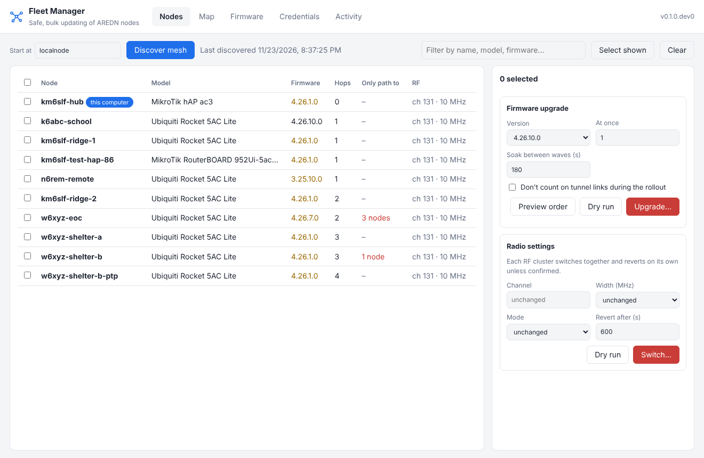

# AREDN Fleet Manager

Safe, bulk management of AREDN® mesh nodes from one PC: discover the mesh, tick the nodes you want, and roll out **firmware upgrades**, **radio settings** and **on/off settings**, with a review of every change before it runs and automatic recovery when something goes wrong.

> **Status: early development.** Firmware upgrades, discovery and settings have run on real hardware (MikroTik hAP ac lite on 4.26.x and nightly, a NanoStation M2 XM on 3.23.8.0 → 3.25.5.1). The radio-change job, including the new LAN Hotspot / WAN Client support, has so far run only against simulated nodes. **Don't point it at a production mesh yet.** Feedback and bug reports are very welcome: see [Feedback](#feedback).



## Contents
- [Why](#why)
- [Goals](#goals)
- [How it works on the nodes](#how-it-works-on-the-nodes)
- [Install](#install)
- [Docker](#docker)
- [Getting started](#getting-started)
- [Firmware upgrades](#firmware-upgrades)
- [Radio settings](#radio-settings)
- [Node settings (on/off switches)](#node-settings-onoff-switches)
- [Older nodes (OLSR era)](#older-nodes-olsr-era)
- [New device (first install)](#new-device-first-install)
- [Safety model](#safety-model)
- [Troubleshooting](#troubleshooting)
- [What's been tested where](#whats-been-tested-where)
- [Known issues and limitations](#known-issues-and-limitations)
- [Command line](#command-line)
- [Development](#development)
- [Feedback](#feedback)

## Why
Upgrading or retuning a mesh one node at a time through each node's web page is slow, and the order matters: take down the wrong node first and you can't reach the ones behind it. Change one end of an RF link and it's stranded until the other end matches. Fleet Manager plans the order, makes RF neighbours change together, checks each step on the live mesh, and stops or reverts rather than pressing on.

## Goals
1. **Never strand a node.** Plan every change around the mesh's real shape: upgrade from the edge inward, switch RF neighbours together, verify on the live mesh, and stop or revert instead of pressing on.
2. **Review before anything changes.** Every job runs as a read-only dry run first, and only the reviewed plan can run.
3. **Follow the firmware, don't hard-code it.** Read settings, labels, channel lists and allowed purposes from each node, so new AREDN releases work without a Fleet Manager update.
4. **Work across a mixed fleet:** many passwords and SSH keys, several firmware generations (3.23 to the nightly), OLSR and Babel, one or two radios per node, and per-node exceptions to group settings.
5. **Nothing to install on the nodes,** and nothing secret written to files or logs.
6. **Easy to pick up:** a Windows app (installer or portable) for club members, plus a headless mode and a command line.

Planned next:
- Automate the New device steps (built-in TFTP push and network-boot server, then the stage-2 upload).
- A Linux `.deb` (desktop and headless service).
- Multi-channel Mesh Stations (the nightly's `radioN_channels`).
- An optional on-node helper package (`.ipk`) for the timed apply-and-revert.
- A field test on a multi-node lab mesh before anyone uses it on a production mesh.

## How it works on the nodes
Fleet Manager needs **nothing installed on the nodes**. It does what each node's own web pages do:
- **Reading:** each node's status page (`/a/sysinfo`, or `/cgi-bin/sysinfo.json` on older firmware), no login needed. Over SSH (port 2222, root): `aredn.radios.getConfiguration()`, the node's own settings dialogs (`/app/main/status/e/*.ut`), `uci -c /etc/config.mesh`.
- **Upgrading:** the image is copied over SSH, checked with `sha256sum` and the node's own `validate_firmware_image`, then installed with `/usr/local/bin/aredn_sysupgrade` (never `--force`). Settings are kept exactly as the node's Firmware page keeps them.
- **Changing settings:** through the node's own ucode module `aredn.configuration` (`prepareChanges` → set → `saveSettings` → `commitChanges`), so `node-setup` decides what restarts and whether a reboot is needed.
- **Channel lists, labels and allowed purposes** come from each node (including `supportsFeature("wifi-mode", …)`), so Fleet Manager offers only what that node's own Radios & Antennas screen would.

Because settings and their labels are read from the nodes rather than built in, Fleet Manager keeps up with firmware changes. The details are in [docs/DESIGN.md](docs/DESIGN.md).

## Install
### Windows
Download from [Releases](https://github.com/km6slf/FleetManager/releases): a numbered release (for example [v0.1.0-alpha.1](https://github.com/km6slf/FleetManager/releases/tag/v0.1.0-alpha.1)), or the [Development build](https://github.com/km6slf/FleetManager/releases/tag/dev-build), which is replaced by every build of `main` (newest, least tested). Each has two files:
- **`AREDN-Fleet-Manager-<version>-setup.exe`**: installs for your user (no admin rights), adds a Start-menu shortcut.
- **`AREDN-Fleet-Manager-<version>-portable-win64.zip`**: no install. Unzip anywhere (even a USB stick) and run `AREDN-Fleet-Manager.exe`. Everything stays in a `data` folder beside it.

The build you're running is shown at the top right of the window (for example `v0.1.0-dev.aa17f60`) and on the first line of every job log. What changed in each build is in [CHANGELOG.md](CHANGELOG.md).

Both use the Microsoft Edge WebView2 runtime, which Windows 10 and 11 already have.

### Docker (Linux, Raspberry Pi, Windows)
Fleet Manager also runs as a container with a web UI you open in any browser. That's handy on a small always-on machine on the mesh, and upgrades become one command. Images are published at `ghcr.io/km6slf/fleetmanager` for Linux (amd64 and arm64, so Raspberry Pi 4/5 work) and Windows containers. Docker picks the right one automatically. See [Docker](#docker) below for setup.

### Linux without Docker
A `.deb` is planned. Until then, run it headless and use any browser:
```bash
pip install "aredn-fleet[serve] @ https://github.com/km6slf/FleetManager/archive/refs/heads/main.zip"
aredn-fleet serve --host 0.0.0.0     # prints a link with an access token
```

## Docker
### What you need
- **Docker** on Linux, or **Docker Desktop** on Windows or Mac. Docker Desktop's default mode (Linux containers) is what most people want, including on Windows. The Windows-container image is for Docker set to "Windows containers" or Docker on Windows Server.
- **A machine cabled to a mesh node** (its LAN port), as with the desktop app. The container reaches the mesh through that machine's network.
- **The address of that node:** the machine's default gateway on that network, for example `10.99.154.177`. On Linux run `ip route` and look for `default via …` on that interface; on Windows run `ipconfig` and look for **Default Gateway** under the adapter cabled to the node.

### Install with Docker Compose (recommended)
1. Download [`docker-compose.yml`](docker-compose.yml) and [`packaging/docker/example.env`](packaging/docker/example.env) into a folder, and rename `example.env` to `.env`.
2. Edit `.env`:
   - `FLEET_SECRETS_PASSWORD`: a long password of your choice. It unlocks the encrypted file in which Fleet Manager keeps saved node and Wi-Fi passwords. **Keep it**: it's needed on every start, and changing it makes saved passwords unreadable.
   - `AREDN_FLEET_DNS`: the node's address from above. Docker's own name lookup doesn't know mesh names, so Fleet Manager asks this node for `localnode` and `*.local.mesh`.
   - `FLEET_TAG` (optional): `dev` (newest build of `main`, the default for now), `latest` (newest numbered release; the first release with a Docker image will be the one after 0.1.0-alpha.1) or a version number to stay on it.
3. Start it:
   ```bash
   docker compose up -d
   docker compose logs fleet        # shows the link to open, with its access token
   ```
4. Open the link in a browser. It sets a cookie, so later visits to `http://localhost:8787/` work without the token. The link stays the same across restarts and upgrades.

By default the web UI only answers on the machine running Docker. To use it from other computers, change `"127.0.0.1:8787:8787"` to `"8787:8787"` in `docker-compose.yml`, and set `FLEET_PUBLIC_HOST` to the machine's name so the printed link points to it. Anyone with the link can manage your nodes, and the connection is plain HTTP like the rest of the mesh; for access beyond your own network, put it behind a reverse proxy with HTTPS.

### Upgrade
```bash
docker compose pull
docker compose up -d
```
This fetches the newest image for your tag: `dev` follows every build of `main` (the default for now), `latest` follows releases. Docker doesn't update a running container on its own; run these two commands (or a tool like Watchtower) to pick up a new build. The build number shows in the web UI and on the first line of every job log; see [CHANGELOG.md](CHANGELOG.md) for what changed.

Everything Fleet Manager keeps (settings, saved passwords, pinned SSH host keys, configuration backups, downloaded firmware, job logs) is in the `fleet-data` volume, so upgrades keep it. To go back to an earlier version, set `FLEET_TAG` to it and run the same two commands.

### Without Compose
Linux:
```bash
docker run -d --name aredn-fleet --restart unless-stopped \
  -p 127.0.0.1:8787:8787 -v fleet-data:/data \
  -e FLEET_SECRETS_PASSWORD='your-long-password' -e AREDN_FLEET_DNS=10.99.154.177 \
  ghcr.io/km6slf/fleetmanager:dev
docker logs aredn-fleet
```
Windows (PowerShell, Docker Desktop in its default Linux-container mode):
```powershell
docker run -d --name aredn-fleet --restart unless-stopped `
  -p 127.0.0.1:8787:8787 -v fleet-data:/data `
  -e FLEET_SECRETS_PASSWORD='your-long-password' -e AREDN_FLEET_DNS=10.99.154.177 `
  ghcr.io/km6slf/fleetmanager:dev
docker logs aredn-fleet
```
Windows containers (Docker switched to "Windows containers"): the same, but with `-v fleet-data:C:\data` and `-p 8787:8787`, or `docker compose -f packaging/docker/docker-compose.windows.yml --env-file .env up -d`. The Windows image is built on Windows Server 2022 (`ltsc2022`); on Windows 10/11 it runs with Hyper-V isolation.

### Settings
| Variable | Needed | What it does |
|---|---|---|
| `FLEET_SECRETS_PASSWORD` | yes | Unlocks the encrypted file with saved node and Wi-Fi passwords (`/data/secrets/passwords.cfg`). Fleet Manager won't start without it, or with one that doesn't open the file. |
| `AREDN_FLEET_DNS` | yes, in practice | Address of the mesh node to look up `localnode` and `*.local.mesh` on. |
| `FLEET_TOKEN` | no | A fixed access token (16+ characters). By default one is made on first start and kept in the volume. |
| `FLEET_PUBLIC_HOST` | no | Host name or address shown in the link in the logs. |
| `FLEET_PORT` | no | Port inside the container (default 8787). |

### Container notes
- **Your machine's routes are used.** The container reaches the mesh (`10.0.0.0/8`) through the machine running Docker. If Docker on your machine is set to use `10.x` addresses for its own networks, change that, or the mesh won't be reachable.
- **SSH keys:** to use an SSH key file, mount it read-only (for example `-v ~/.ssh/aredn:/keys/aredn:ro`) and add it on the Credentials tab as `/keys/aredn`.
- **Not in the container:** the desktop window, the leftover-route check (it inspects Windows' own routes), and **Open folder** buttons. Files such as backups are in the volume (`docker cp aredn-fleet:/data/config/backups .` copies them out).
- **Back up the volume** together with your `FLEET_SECRETS_PASSWORD`, for example `docker run --rm -v fleet-data:/data -v "$PWD":/backup alpine tar czf /backup/fleet-data.tgz -C /data .`

## Getting started
1. **Connect your PC to a node** by Ethernet (its LAN port), so `localnode` is that node.
2. **Add your logins** on the **Credentials** tab: SSH keys (by file path) and/or node passwords. A fleet rarely shares one password, so add every one you use; Fleet Manager tries them in turn and remembers which works for each node. Passwords go to Windows Credential Manager, never to a file.
3. **Discover the mesh** on the **Nodes** tab (start at `localnode`). You get every node it can reach with its model, firmware, routing badge (**Babel**, **OLSR+Babel** or **OLSR**), hops from you, and whether it's the *only path* to other nodes.
4. **Download firmware** on the **Firmware** tab: the two newest stable releases plus the nightly, for the hardware in your mesh. Every image is SHA-256 checked against AREDN's published hash.
5. **Select nodes** with the checkboxes (or click them on the **Map**), then use the cards on the right.

Every change follows the same pattern: **Dry run** (read-only; logs in and checks every selected node) → **review** what will happen → type the confirmation word (`upgrade`, `switch` or `apply`) → it runs, logging to the **Activity** tab, where you can copy or save the log.

In the review, **Remove** next to a node (or **Remove blocked** / **Remove already current** at the top) deselects it and checks the plan again. A blocked node keeps the Go button locked, so this is how you go ahead with the rest. What runs is always exactly what you reviewed last.

## Firmware upgrades
- **Preview order** shows the waves: outermost nodes first, your own node last, so nothing is upgraded while a node behind it still needs to be reached. Nodes that are the only path to others are flagged.
- **Dry run** checks each node: login, board name, exactly one matching image, free RAM, and whether it's already on that version.
- **Upgrade…** shows the review (wave by wave: current → new firmware, or BLOCKED with the reason), then runs. Each node's configuration is **backed up to your PC first** (`<node>-<time>-<old version>.tgz`); if the backup fails, that node isn't touched. After each node comes back, Fleet Manager checks its version and that its neighbours and the nodes behind it are reachable again, waits a soak time, then moves on. **It stops at the first failure.**
- **One specific release:** the Firmware tab can fetch any stable release, for example a node's last supported one.
- **Hardware AREDN no longer supports:** if the chosen release has no image for a node, the review says which release is its last.
- **Release candidate safeguards** (from AREDN's RC notes): PtMP access points go before their Mesh Stations; AC radios on removed channels (48–64) are blocked; IPQ40xx units upgrading from 4.26.7.0 are flagged as possibly needing a power cycle.
- **OLSR → Babel:** moving a node to Babel-only firmware (4.26 and later) is blocked if it would cut off OLSR-only nodes, or leave it with no Babel path back to you. See [Older nodes](#older-nodes-olsr-era).

## Radio settings
The **Radio settings** card has one section per band the selected nodes have (900 MHz, 2.4, 3.4, 5, 6 GHz), showing each node's current settings. Press **Read radios** first; this logs in read-only.
- **Purpose:** Mesh, Mesh PtMP, Mesh Station, Mesh PtP, **LAN Hotspot**, **WAN Client** or Off, limited to what every selected radio supports (as the nodes report it; tiny builds offer only Mesh and Off).
- **Width and channel:** the same lists, labels and limits as the node's own screen (ham power, DFS, indoor), narrowed to what every selected node offers.
- **Mesh SSID:** defaults to `AREDN` (shown as the full broadcast name, e.g. `AREDN-10-v3`); groups that use their own, such as IDEC, can change it.
- **LAN Hotspot:** network name, security (WPA2 PSK, WPA PSK or open), password, and a channel from the node's hotspot list. Runs at 20 MHz.
- **WAN Client:** the network to join and its password (or "no password"). Only one radio per node can be a WAN Client.
- **Passwords are never logged, shown in reviews, or written to Fleet Manager's files.** For group changes you type them for that change. A WAN Client's network name is hidden in logs too.

How a change runs:
1. Nodes are grouped into **RF clusters** (joined by RF links). Each cluster switches **at the same moment**, so links come back on the new settings together.
2. Each node gets a small script that backs up its settings to flash and **reverts by itself** (even across the reboot the change needs) unless Fleet Manager confirms within the revert time (default 600 s).
3. Afterwards Fleet Manager checks each node live: the radio is on the expected frequency and mode (`iw`), a hotspot is broadcasting its name, a WAN Client has joined its network, and every RF neighbour that should still be linked is back.
4. **All or none:** only if every node in the cluster checks out does it confirm them; otherwise none are confirmed and the whole cluster reverts together.

The review shows before → after for every node and radio, links that will drop on purpose, and unselected neighbours that will lose links.

**Node-specific settings:** use **Set…** in a node's **Own settings** column to give it its own purpose, channel, width, SSID or hotspot/client settings on any band, with a note (for example "PtP backhaul"). It stays in the group for upgrades and for its other bands; on that band, group changes don't apply to it, and anything left blank keeps its current value. A purple **custom** marker shows these nodes. Passwords for a node's own hotspot or client are kept in Windows Credential Manager, not in a file.

## Node settings (on/off switches)
The **Node settings** card lists every on/off switch the selected nodes' own settings pages have (for example *Allow other MESH nodes to use my WAN*, *Enable telnet access*, *IPERF Enable*), with each node's own labels and how many are on or off. Choose **On**, **Off** or **Leave** for each, then **Dry run** and **Apply…**.
- Fleet Manager reads these from each node's dialogs, so it follows whatever the node's firmware offers. Switches a node doesn't have aren't changed on it.
- Switches that do more than flip one setting are listed but left to the node's own page. *Enable SSH access* is never changed in bulk, since it could cut Fleet Manager off.
- If a change needs a reboot, the review says so, and the result lists the nodes to reboot (Fleet Manager doesn't reboot them).

## Older nodes (OLSR era)
- **Routing history:** up to 3.25.4, nodes speak only OLSR; 3.25.5.0–3.25.10.0 speak OLSR and Babel; 4.26.1.0 and later only Babel. Babel-only nodes can't see OLSR-only ones.
- **Tiny builds** (32 MB hardware such as the NanoStation M XM) stop at **3.25.5.1** and never get Babel, so they stay OLSR-only and can't join a Babel-only mesh. Fleet Manager labels them **OLSR**.
- **Upgrades from the Lua-UI era (3.23 and earlier)** follow the node's own Firmware page: keep-list archive, image checks, then a second reboot to apply the kept settings.
- **Settings on older nodes** go through their own Advanced Configuration page.
- **Radios on older nodes** can be read (view only); changing them needs 3.25.5 or later.

## New device (first install)
The **New device** tab guides putting AREDN on new hardware, following AREDN's install guide:
1. Pick a release and search AREDN's hardware list; each entry shows its install method.
2. **Get the files and show the steps** downloads and checks the images the method needs, and makes copies under the names devices ask for (`rb.elf` for MikroTik network boot, `recovery.bin` for TP-Link).
3. Follow the steps (PC address, device address, when to hold reset), ticking each off.
4. **Look for the node** checks whether the new node is answering.

Covered: Ubiquiti 802.11n (TFTP), Ubiquiti 802.11ac (advanced), MikroTik (network boot then upgrade), TP-Link CPE/WBS, GL.iNet, Cudy, OpenWrt One, Zyxel, x86. Other hardware gets a link to AREDN's guide and every image AREDN publishes for it. The TFTP and network-boot steps are manual for now.

## Safety model
- **Dry run first, always.** Real changes need a typed confirmation, and **only the plan you reviewed can run** (it must match a recent dry run of the same nodes and settings).
- **Stop at the first failure;** never work past a failed node toward your own.
- **Outermost first** for upgrades; **whole RF clusters at once** for radio changes, reverting on their own unless confirmed.
- **Back up before flashing.** Backups (which can contain the node's password hash and Wi-Fi keys) stay on your PC.
- **Retries only for reads.** A lost packet won't fail a read or a login, but a step that changes a node is never repeated.
- **SSH host keys** are pinned on first use; a changed key is refused.
- **No secrets in files or logs:** node passwords and Wi-Fi passwords live in Windows Credential Manager or are typed for one change.

## Troubleshooting
- **Reads or logins time out when Wi-Fi is on.** Fleet Manager looks up `*.local.mesh` names on the node you're cabled to, so your PC's DNS doesn't matter. If it still happens, look at the log: when a node can't be reached, it shows how each neighbour sees the link (errors %, SNR, round trip), the same figures as the node's Neighborhood Nodes table.
- **"A leftover route on this PC".** After moving your cable from one node to another, Windows can keep the old node's route to the mesh, and some connections then fail at random. Fleet Manager detects this and shows the `route delete …` command to run as administrator (it never changes routes itself). Unplugging the cable for a few seconds often clears it too.
- **Nodes close together on a bench.** Two nodes a metre apart at full power can overload each other (high "errors" on their link). Lower the transmit power for bench tests.
- **A node shows "no known path".** It answers, but none of the nodes Fleet Manager read lists a link to it (usually a tunnel, or a link the node doesn't name). Discovery finds such nodes from your node's own node list. You can read and change their settings, but upgrades skip them, because Fleet Manager can't work out a safe order without knowing how they're connected.
- **A node shows "routing?" or no firmware.** Discovery couldn't read its status page; run **Discover mesh** again. Upgrade reviews also re-read it.
- Logs from every job are saved under `%APPDATA%\aredn-fleet\logs\jobs` (or `data\` in the portable version); **Copy log** on the Activity tab copies one.

## What's been tested where
| Feature | Real hardware | Simulated / tests |
|---|---|---|
| Discovery, status reads (4.26, nightly, 3.25, 3.23) | ✓ | ✓ |
| Firmware upgrades (4.26.1.0 → 4.26.10.0 → nightly; 3.23.8.0 → 3.25.5.1) | ✓ | ✓ |
| On/off node settings (nightly dialogs; 3.23 Advanced Configuration) | ✓ | ✓ |
| Read radios (nightly, 3.25.5.1, 3.23.8.0) | ✓ | ✓ |
| Radio change job (clusters, revert, verify) | not yet | ✓ |
| LAN Hotspot / WAN Client | not yet | ✓ |
| New device wizard (file preparation and steps) | not yet | ✓ |

## Known issues and limitations
**Not yet proven on real hardware**
- **Radio changes** (synchronized cluster switch, automatic revert, live checks) have only run against simulated nodes. The first real two-node test is next.
- **LAN Hotspot and WAN Client** are new in this build and have only run against simulated nodes.
- **New device** prepares the files and steps, but no install has been done with it yet.

**Limitations**
- **Windows only** for the desktop app. Linux and Raspberry Pi run the [Docker image](#docker) or headless from source; the `.deb` isn't built yet. There's no macOS desktop build (Docker Desktop for Mac runs the Linux image).
- **The Docker images are new:** they're built, started and health-checked automatically, but haven't yet managed a real mesh.
- **Tiny-build hardware** (32 MB units such as the NanoStation M XM) ends at 3.25.5.1 and never speaks Babel, so it can't join a Babel-only mesh. That's an AREDN limitation; Fleet Manager labels these nodes OLSR and blocks upgrades they can't take.
- **Discovery only sees nodes your PC can reach.** Babel-only and OLSR-only nodes can't see each other, so nodes on the other side of that boundary don't appear.
- **Radio changes are refused** on a node with two radios on the same band, on 900 MHz (HaLow) hotspots, and on nodes older than 3.25.5 (their radios can be read, not changed).
- **Multi-channel Mesh Stations** (nightly) aren't supported yet: setting a channel clears a station's extra channels, as the node's own page does.
- **If confirming a radio change fails partway through a cluster,** nodes already confirmed keep the new settings while the rest revert.
- **Settings that do more than flip one switch** are listed but left to the node's own page, and *Enable SSH access* is never changed in bulk.
- **Fleet Manager doesn't reboot nodes** after on/off settings that need it; it lists them for you.
- **The leftover-route check** only runs on Windows.

**Things that can look like bugs**
- **The first Read settings** on a firmware version Fleet Manager hasn't seen copies that firmware's settings pages from the node, so it's slower over a weak link. Later reads are quick.
- **Two nodes close together at full power** can overload each other's receivers (high "errors" on the link), causing timeouts. Lower the transmit power for bench tests.
- **Older firmware upgrades take longer:** 3.23-era nodes reboot twice, and the job waits for both.

Please report anything else on [GitHub Issues](https://github.com/km6slf/FleetManager/issues).

## Command line
```bash
pip install -e ".[dev,gui]"
aredn-fleet gui                              # the desktop app from source
aredn-fleet firmware channels                # 2 newest stable + newest nightly
aredn-fleet firmware fetch                   # sysupgrade images for all hardware, SHA-256 checked
aredn-fleet firmware fetch --board mikrotik,routerboard-952ui-5ac2nd   # one hardware type
aredn-fleet creds add fleetkey --key ~/.ssh/aredn_ed25519
aredn-fleet creds add oldpw --password-env AREDN_PW_OLD
aredn-fleet discover -o mesh.json            # crawl from localnode
aredn-fleet plan mesh.json --root <your-node> --parallel 2
aredn-fleet upgrade mesh.json --root <your-node> --version 4.26.10.0             # dry run
aredn-fleet upgrade mesh.json --root <your-node> --version 4.26.10.0 --execute
aredn-fleet radio mesh.json --channel 133 --width 10                    # dry run; --execute to switch
```

## Development
```
src/aredn_fleet/        controller: discovery, topology planner, firmware catalog, jobs, CLI
src/aredn_fleet/web/    GUI: FastAPI app + static HTML/JS/CSS (no build step), shown with pywebview
packaging/windows/      PyInstaller spec, Inno Setup installer, portable build
packaging/linux/        .deb plan
agent/                  optional on-node helper (.ipk) for staged apply / auto-revert (planned)
docs/DESIGN.md          design, safety model and field findings
docs/NIGHTLY.md         notes on the release-candidate / nightly features
tests/                  pytest; includes the on-node scripts run under a POSIX shell with stubbed AREDN tools
```
```bash
pip install -e ".[dev,gui]"
pytest
```
CI runs the tests on Python 3.10, 3.12 and 3.13, builds the Windows installer and portable zip, and self-tests the bundle.

## Feedback
Issues and suggestions are welcome on [GitHub Issues](https://github.com/km6slf/FleetManager/issues). Especially useful: firmware versions or hardware that behave differently from what Fleet Manager expects, and anything in a dry-run review that looks wrong. If you report a problem, the job's log (**Copy log** on the Activity tab) helps a lot. Please remove anything private first; Fleet Manager keeps passwords out of its logs, but node names and addresses are in them.

License: GPL-3.0. AREDN® is a registered trademark of Amateur Radio Emergency Data Network, Inc. This project is not affiliated with or endorsed by AREDN.
